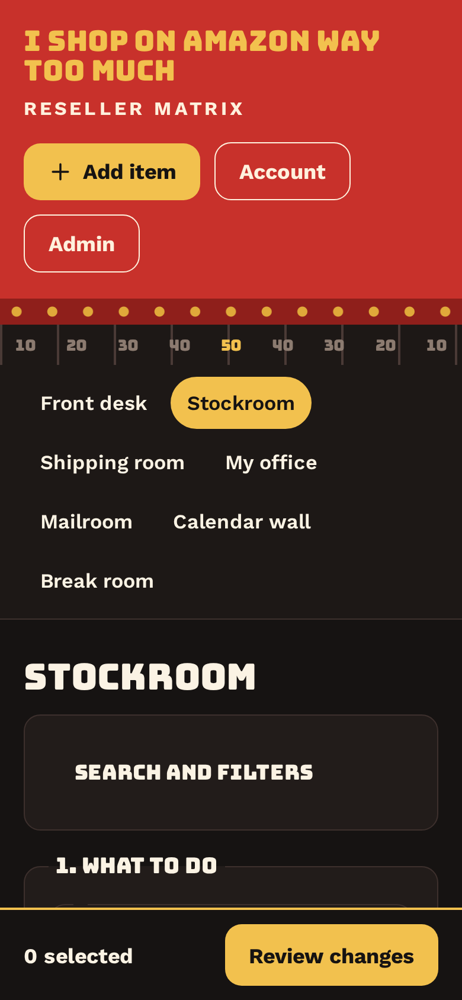
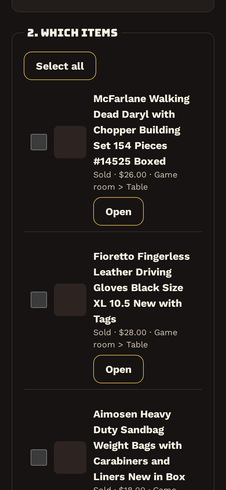
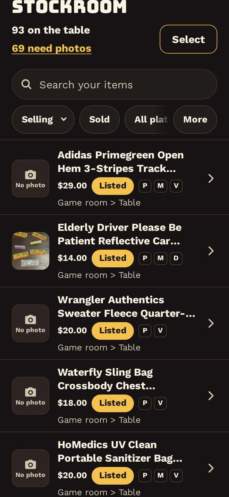
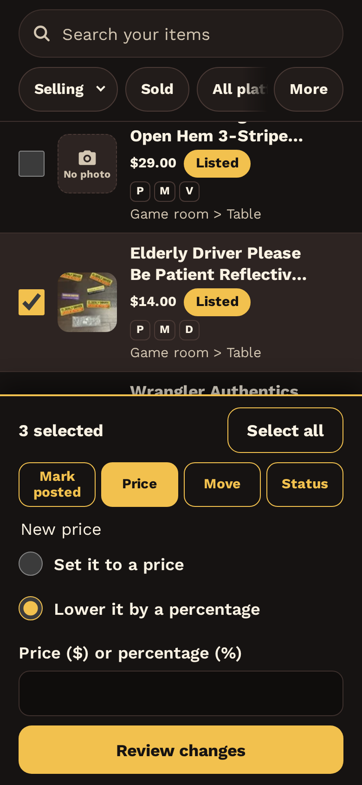
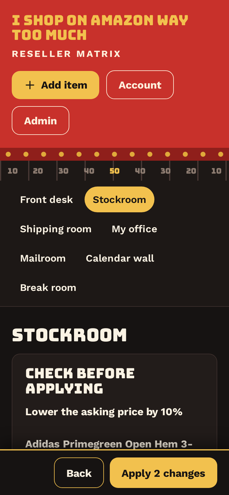
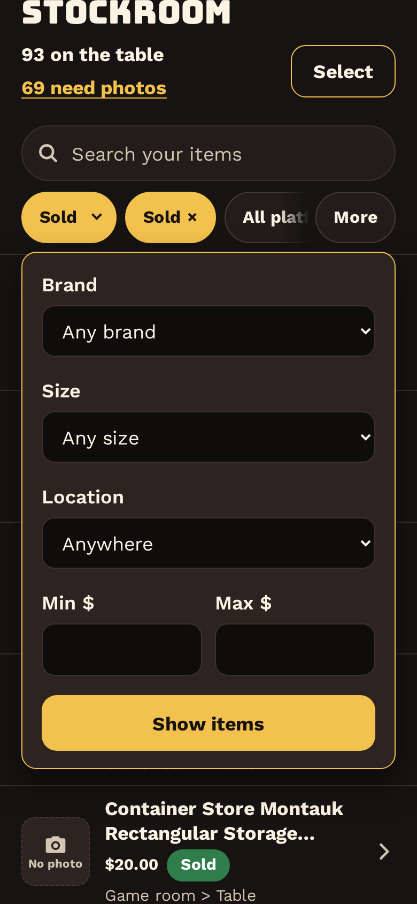
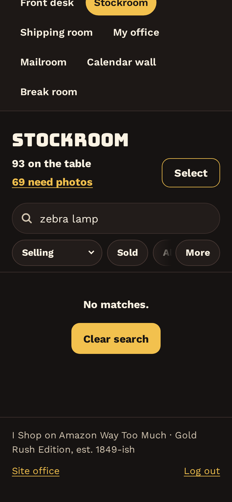
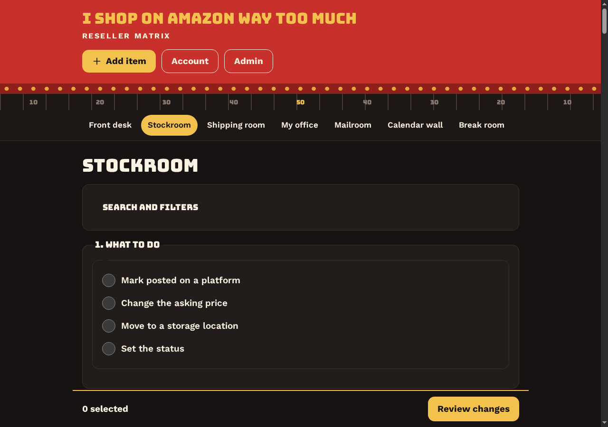
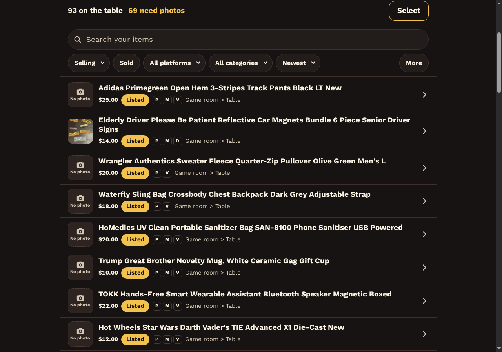

# 2026-10-18: Stockroom redesign: list first, whole rows open the item (punch 622)

- Date: 2026-10-18
- Phase: 10 (Phase 10: bring in Cody's current listings)
- Commits: 9cc95b0
- Crew only (hidden from Cody on the site)
- Site office node: 624

## Summary

The Stockroom is rebuilt around the list, the way Liam described in punch 622 (iOS Mail / Files). The page shows the count
("93 on the table"), a search box and filter chips pinned at the top, and then the items. Each row is a single tap
target that opens the item. **Select** (top right) turns on checkboxes, and a bar with Mark posted / Price / Move /
Status slides in at the bottom once something is ticked. The Review step that comes before Apply works as it did
before. Part 2 (money accuracy) is only a proposal, under Decisions needed, and nothing is built for it. It waits for Liam's OK.

## What was done

**Before** (iPhone width): "1. What to do" comes first, sold items sit at the top, and every row needs its own Open button.

**After** (iPhone width):

- **List first.** The header shows the count of items still selling (draft + ready + listed = 93, the same number as the
  Front desk tile) and a gold "69 need photos" link that opens the Add photos page for the next item. The "1. What
  to do / 2. Which items" scaffolding is gone.
- **Search and chips stay pinned** while the list scrolls. As Cody types, the search filters the rows already on the
  page. Pressing Enter searches every status on the server, so the Mailroom's "Find it" links still find sold
  items. Chips:
  **Status** (default *Selling* = Listed + Ready + Draft; also each status and *Every status*), **Sold** (its own chip,
  tap again to turn it off), **Platform**, **Category**, **Sort** (Newest, Price high to low, Price low to high, Longest
  listed), and **More** (brand, size, location, min/max price: the old filters, kept). A chip applies as soon as it
  changes. Every view has its own link.
- **Whole row is the link**: a 64px rounded thumbnail (dashed camera placeholder with "No photo" when the item has
  none), the title on up to 2 lines, then price, status chip, platform pills for live listings (P, M, eB, D, G, V, FB,
  with the full name on hover) and the location in muted text, and a chevron. Rows are at least 72px tall, with
  full-width hover and pressed states and a gold focus ring. The link's accessible name is the title only (meta via
  aria-describedby). The Open and per-row Add photos buttons are gone.
- **Select mode** (no checkbox inside a link): the checkbox sits next to the row link. In select mode a tap on the row
  ticks it instead of opening it. **Done** (or Esc) leaves select mode and clears the ticks. "Select all" ticks
  the rows on screen, so it respects the search.
- **Bottom bar** appears only when something is ticked: "3 selected", Select all, the four actions as toggle buttons,
  their options, then **Review changes**. It sits above the iPhone home bar (safe-area inset).

- **Empty, loading and no-results states**: "No matches." with **Clear search** (when typing) or **Clear filters**
  (when the server finds nothing). With no items at all, the page shows "No items yet." with Add item. While a chip
  reloads the page, the list dims. Thumbnails lazy-load. The list shows 50 rows at a time with "Show more (N left)".

**Desktop** (1280 wide), before and after:

- Reseller Matrix theme throughout: gold on charcoal, 19px text, every tap target 48px or more.
- Without JavaScript the page still works: rows open items, the chips apply with a Show items button, and the
  checkboxes and bar are always shown.
- **Site office**: build reports can now show screenshots. Files go in private://office-screenshots and are served
  at /site-office/screenshots/NAME.png to crew only (webmaster, site-foreman; the owner gets 403). The
  office_markdown format now allows ``.

## What's next

- Liam: OK (or changes) on Part 2. Building both takes about an hour.
- Cody will see the new Stockroom the next time he opens it. Nothing for him to do. His item 620 (Add photos) is
  answered "done".
- Phase 9 B: marketplace inbox (preview on real mail, tune, switch on).

## Blockers

None.

## Decisions needed

Part 2 of punch 622, money accuracy. These are proposals only and wait for Liam's OK:

1. **Undated imported sales.** 15 of the 21 imported sold items had no sale date, so they are dated 2026-10-18 (import
   day). That puts **$549.42** into "Sold this month" for October. Proposal: mark them "sold before the site" so they
   count in All time only, never in this month or this season. The 6 sales with real dates (27 Aug to 7 Sep, $66) keep
   their dates.
2. **Scoreboard "Listed".** That number counts platform listings (266 live right now), while the Stockroom counts 93
   items. Proposal: the big number becomes items listed, with "N listings across your sites" as a small line
   under it.

## Tests

- Unit tests: 100 pass (new: Status default and search-everywhere rules, category and sort parsing).
- phpcs Drupal/DrupalPractice: no errors (the 4 warnings were already there).
- Every filter URL renders with the expected rows: default 93, Sold 21, Every status 114, Depop 15, a category 22,
  "wrangler" 3. Price sorts put items with no price last.
- In headless Chromium at iPhone size: Select, then tap 3 rows, gives "3 selected" and the bar. Price, then lower by
  10%, then Review changes, opens "Check before applying" with "Apply 2 changes". Apply was **not** pressed, and no
  revisions were saved. No PHP errors logged.
- Screenshot route: crew gets 200 image/png, anonymous gets 403, a missing file or a path with `../` gets 404.
- Known gap: all 266 live listings carry the import date as their posted date, so "Longest listed" falls back to
  oldest item first until real posting dates exist.
