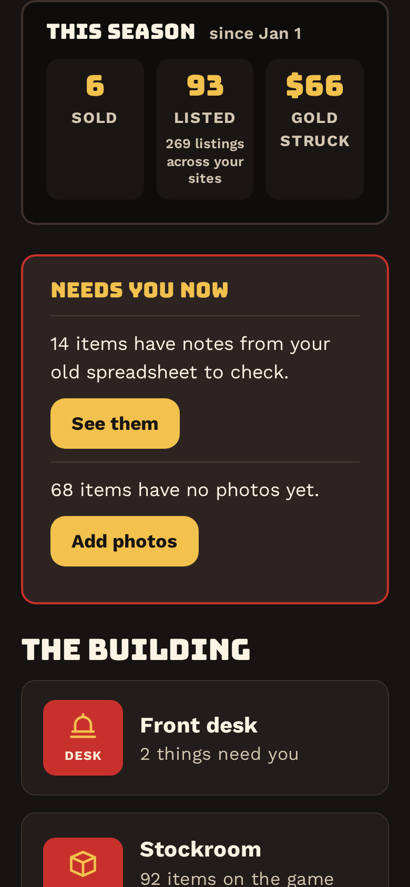
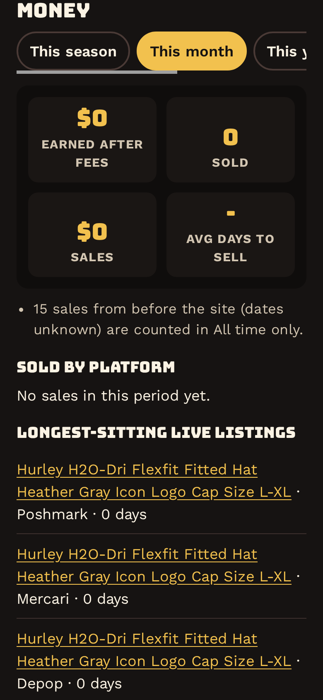
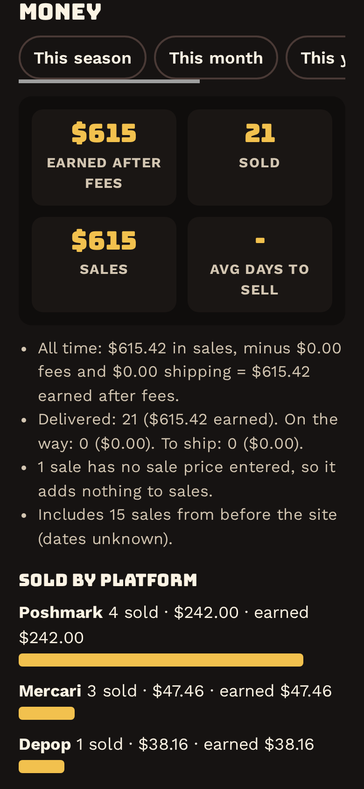

# 2026-10-18: Money after the import: sales from before the site, Listed counts items (punch 622 part 2)

- Date: 2026-10-18
- Phase: 10 (Phase 10: bring in Cody's current listings)
- Commits: 2aec4d9
- Crew only (hidden from Cody on the site)
- Site office node: 625

## Summary

Liam said yes to both parts of the proposal, and both are built. The 15 imported sales that had no date now count in
All time only, so October no longer shows $549.42 of old sales. The scoreboard's Listed number counts items (93),
with "269 listings across your sites" as a small line under it.

## What was done

- **"Sold before the site" flag** on sales (listing field `date_sold_unknown`, update 11011). It was set on the 15
  sales from Cody's import that had no date in the spreadsheet. They keep the import day as a stand-in date, because
  every sale must have one.
- **Where they count.** All time includes them, with the note "Includes 15 sales from before the site (dates
  unknown)". This month, this season, this year and last year leave them out, with the note "15 sales from before
  the site (dates unknown) are counted in All time only".
- **Tax export.** It keeps them in the import year (2026), dated "Before 2026-10-18 (date unknown)". Income is still
  income, even when the day is unknown. Liam: say if you'd rather list them separately.
- **The flag goes away by itself** when someone enters the real Date sold, or when the sale is undone. The listing
  form shows it as a checkbox. Future imports set it on any sold row with no date. The preview note now says so.
- **Days to sell** skips these sales. It also skips imported sales whose posted date (the import day) is after the
  day they sold. Before this fix, All time showed **-46 days**. It now shows "-" until real sales come in.
- **Scoreboard.** Listed is now the number of items posted this season (93), with "269 listings across your sites"
  under the label. Both numbers leave out items sold before the site, because their listings only carry the import
  day.

## What's next

- Phase 9 B: marketplace inbox (preview on real mail, tune, switch on).

## Blockers

None.

## Decisions needed

None. One thing for Liam to know: at 08:38 Cody deleted the Adidas track pants item himself (sheet row 36, the one
he had unticked during his import and that was added back on Liam's word). The Stockroom now has 92 on the table.
I left it deleted.

## Tests

- Unit tests: 101 pass. New: date-unknown sales count but stay out of days to sell, and so do spans where the
  posted date is after the sale.
- Update 11011 ran (database dump first: /var/backups/ishop/pre-sold-before-site-20261018-0840.sql.gz) and marked 15
  sales. Entity schema is in sync, and no PHP errors were logged.
- Figures after the change: this month has 0 sales. This year has 6 sales, $66. All time has 21 sales, $615.42 (15
  of them undated). The 2026 tax export has 21 sales, $615.42. The scoreboard shows 6 sold, 93 listed (269
  listings), $66.
