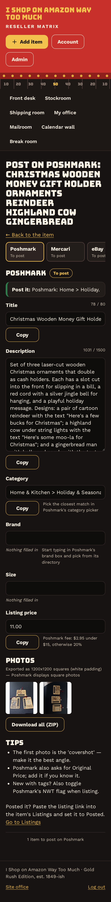
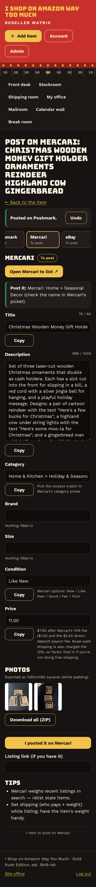
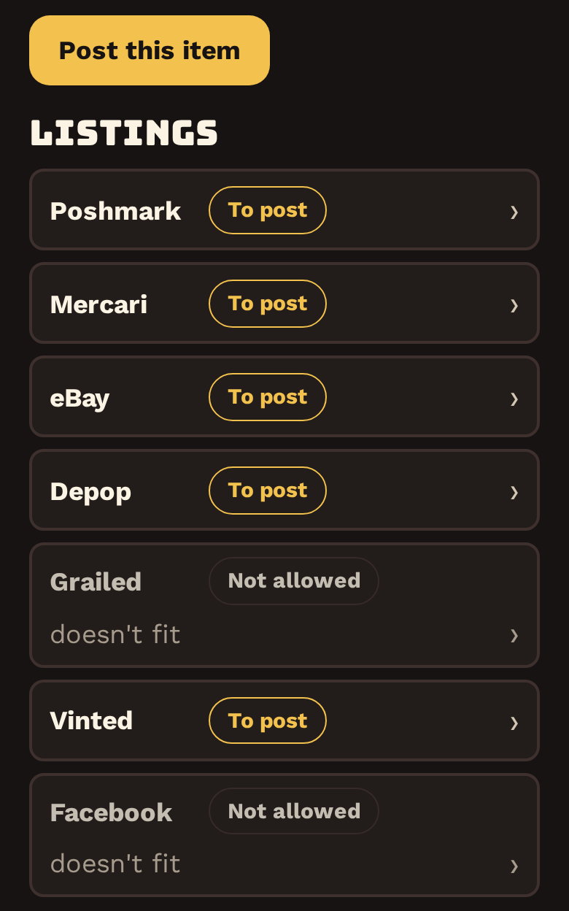
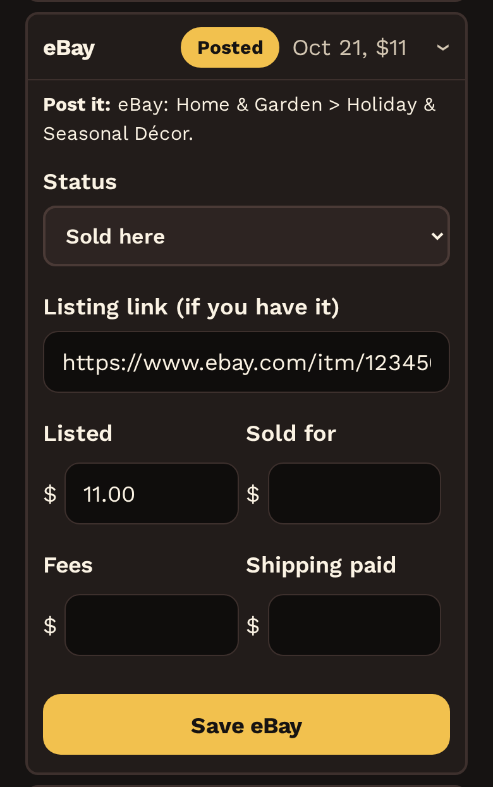

# 2026-10-21: Posting flow simplified (one tap "I posted it")

- Date: 2026-10-21
- Phase: handover (Handover countdown: finish the build, then close the site office)
- Commits: 216eb03
- Site office node: 646

## Summary

Posting is now one tap per site. On the Post page Cody taps **Open <Platform> to list**, copies the fields and photos, then taps **I posted it on <Platform>**. That marks it Posted at the asking price with today's date and moves on to the next site still to post. **Undo** shows for 10 seconds. The listing link is optional and never asked for, and the "Go to Listings" hand-off is gone. Sites that don't fit the item are set to Not allowed by themselves and left off the tabs. The item page's Listings are compact rows. The item's status follows its listings. Tested at iPhone width on item 644, then put back exactly as Cody left it. Decision 645.

## What was done

- **Post page:**
  - "Open <Platform> to list" opens the site's new-listing page in a new tab. On the iPhone it opens the app if it's installed.
  - After the fields and photos there's a big **I posted it on <Platform>** button, with an optional "Listing link (if you have it)" box under it. A link from the wrong site gets a plain error ("That's a Poshmark link, not eBay").
  - After a tap, a green bar at the top says "Posted on <Platform>" and has **Undo**. It hides itself after 10 seconds. Undo puts back the status, price, date and link exactly as they were, from the listing's previous revision.
  - After the last site, the bar says it's posted everywhere it fits.
  - The "Paste the listing link... Go to Listings" text is removed.
- **New-listing links**, checked from the server on 2026-10-21:
  - Poshmark `poshmark.com/create-listing` and Vinted `vinted.com/items/new`: the sign-in page returns to the listing page.
  - eBay `ebay.com/sl/sell`: 200.
  - Facebook `facebook.com/marketplace/create/item`: goes to the mobile version of the same page.
  - **Not confirmed:** Mercari `mercari.com/sell/`, Depop `depop.com/products/create/` and Grailed `grailed.com/sell/new` show bot-check pages to the server ("Just a moment", "Forbidden", Cloudflare). Their help pages don't publish the URL, so these three are the paths their sites use, unconfirmed.
- **Sites that don't fit:** when the rules say Skip or Not allowed, To post listings become **Not allowed**, flagged as set by the site. This runs when an item is added or changed, and update 11012 applied it to the one item there is: item 644's Grailed and Facebook. If an item changes so a site fits again, a flagged listing goes back to To post. Not allowed set by hand is never touched. These sites are left out of the Post page tabs, the to-post queue and the digest counts. To post on one anyway, Cody opens its row on the item page and chooses To post. That records "Added by hand" as the eligibility override, so the site doesn't flip it back.
- **Item page Listings:**
  - One compact row per site: name, status chip and a short summary ("Posted · Oct 21, $11", "Not allowed · doesn't fit").
  - Tap a row to open its status, link and listed price, with its own Save button.
  - Sold for, fees and shipping only show once Sold here is chosen. The Sold-here confirmation and cascade are unchanged.
- **Item status follows:** Draft or Ready becomes Listed when any site is Posted. When none are posted any more, it goes back to Ready (Draft if the ready checklist isn't complete). Sold, donated and kept items are left alone.
- **Docs package:**
  - `handover-cody.md` has a new "Posting an item" section. It also says the site doesn't post to the marketplaces (no public APIs; automating them breaks their terms), that eBay posting depends on the API appeal, and that paid crosslisting services are the option for one-tap crossposting.
  - The same note is in `overview.md`. `architecture.md` and `decisions.md` are updated, and the zip is rebuilt.
- Database dump first: `/var/backups/ishop/pre-posting-flow-20261021-0628.sql.gz`.

### Before

The Post page ended with "Posted it? Paste the listing link... Go to Listings":

The item page had a 7 x 6 grid of status, URL and money boxes:

### After

Right after tapping "I posted it on Poshmark": the Undo bar, and on to Mercari:

Item page Listings (Grailed and Facebook set to Not allowed automatically):

A row opened with Sold here chosen: Sold for, fees and shipping appear:

## What's next

- Cody posts item 644 with the new buttons.
- Stage B (site office removal) still waits for Liam's go.

## Blockers

None.

## Decisions needed

- Liam: should Cody check the three unconfirmed links (Mercari, Depop, Grailed) by tapping each "Open ... to list" once? If so, I'll open a short punch item for him. Otherwise any wrong link gets fixed when he reports it.

## Tests

All run on item 644 in headless Chromium at iPhone width (390 px, iPhone Safari user agent), signed in as theowner. The test session was deleted afterwards.

- I posted it on Poshmark (no link): Poshmark Posted, $11.00, dated 2026-10-21. The item went Draft -> Listed and the page moved on to Mercari with the Undo bar.
- Undo: Poshmark back to To post with no date, and the $11.00 Cody had typed kept.
- Wrong link (a Poshmark link on eBay): error, nothing saved. A real eBay link: eBay Posted with the link stored.
- Item page: the eBay row summary says "Oct 21, $11". Its money fields are hidden until Sold here is chosen, then appear (not saved).
- Grailed set to To post by hand: override Yes, note "Added by hand on the item page.", no longer flagged.
- eBay set back to To post on the item page with nothing else live: the item went Listed -> Ready.
- Undo bar timer: present on load, gone after 11 seconds (page 91 px shorter).
- **Put back afterwards:** all 7 listings and the item status are exactly as before the test (5 To post at $11.00 with no date or link, Grailed and Facebook Not allowed by the site, item Draft). The test steps stay in the listing revision history, ending with "Test postings undone".
- No PHP errors or warnings in the log during the tests. All changed PHP files pass `php -l`. No phpunit on the server any more (removed at close-out).
