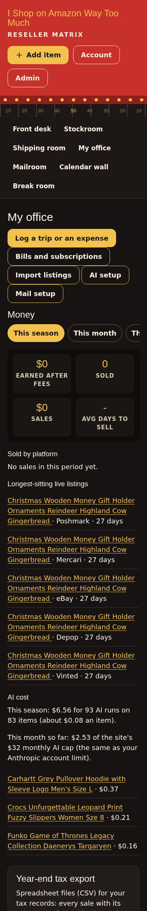
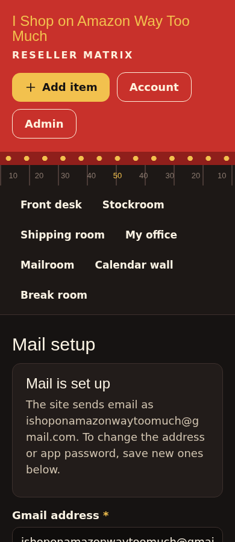

# 2026-11-17: Go-live part 3, the go-live look

- Date: 2026-11-17
- Phase: handover (Handover countdown: finish the build, then close the site office)
- Commits: ff67968
- Site office node: 740

## Summary

Cody's account and visitors no longer see anything that looks like a build site. Visitors get the Reseller Matrix login and nothing else. Cody's account can't see the site office at all: no menu link, no reports, no status board. His AI setup and Mail setup are now in **My office**, in the Reseller Matrix look. The public shop stays off.

## What was done

**How it was checked.** I crawled the site through Drupal's kernel as anonymous and as `theowner`: every reachable page, plus one example of each item page. The crawl was read-only, inside a rolled-back transaction, and skipped logout and any link with a token. On each page I searched the visible text, titles, alt text, placeholders and button labels for: construction, work zone, crew, under construction, building something, being built, coming soon, site office, foreman, Claude, "Phase N", punch list.

**Found and fixed (as theowner):**
- Every page had a **Site office** menu link ("Plans, status board, build reports, punch list and decisions"). Cody could open every report and `status.json`.
  - Fix: the site office is now **crew only** (webmaster, site-foreman). All `/site-office` routes need crew, and every office node is crew-only (grants rebuilt, node lists filtered).
  - Cody's account now gets 403 on the board and lists, 404 on reports, and 0 office nodes in any listing. Webmaster still gets 200 everywhere.
- **AI setup and Mail setup** were at `/site-office/...` in the Construction theme. Moved to `/room/my-office/ai-setup` and `/room/my-office/mail-setup` (the public-shop switch to `/room/my-office/public-shop`, not linked). My office has **AI setup** and **Mail setup** buttons, and the panels are styled in the Reseller Matrix theme. All site links (emails, Needs you now) follow the new paths.
- **My office** ended with a "Coming soon … This room is being built" card: removed. The generic `/room/{room}` page now goes to the front desk; every room has its own page.
- Error messages said "tell site-foreman" or "tell the site office": now "tell Liam" (7 messages).
- The item form's private-notes help said "Only the crew sees these": now "Only you see these: never shown on listings."

**After the fixes:** 45 pages crawled as theowner, with no hits except his own account form, which lists the **Site office** and **Site foreman** roles (he is an administrator). Those roles are removed in Part 6.

**Visitors (anonymous):** `/` and every room 403 to the Reseller Matrix login page ("Reseller Matrix / Log in / Username / Password"). `/user/password` works. `/shop` 404s (switch off). No banned words.

**Screenshots (iPhone width, fallback fonts):**

## What's next

Part 4: rebuild the documentation zip (everything since 10/21 and the final state).

## Blockers

None.

## Decisions needed

- Cody can no longer answer punch items (the office is crew-only). There are no open Cody items. Anything for him from now on goes by message or email.
- The Construction theme, site office, site-foreman role and Webform are still installed until Part 6.

## Tests

- Crawls: anonymous (10 pages), theowner (45 pages), webmaster spot checks.
- Office access checked per account.
- Screenshots of the moved pages; a long-address overflow on Mail setup was found and fixed.
